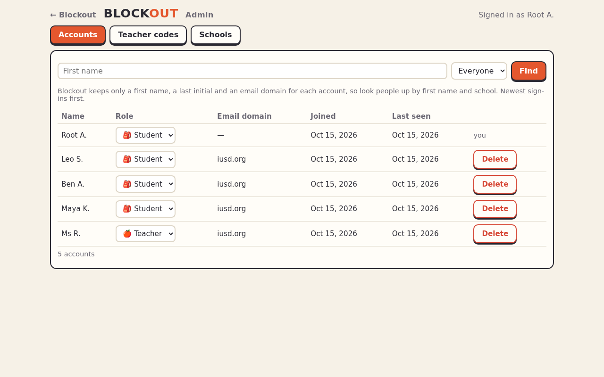

<title>Admins</title>

# Admins

Admins look after the accounts: who's a teacher, removing accounts on request, and the schools Blockout knows. An admin is an account with the `admin` role in Keycloak ([how to give it](set-up-keycloak.md#make-someone-an-admin)); on a practice server, tick **Admin** in the dev sign-in.

Open **Admin** on your account page, or go to `/admin/`.

## How roles work

- **Everyone who signs in starts as a student.** Signing in never changes a role.
- **A teacher code** makes a student account a teacher. Admins make them, and so do teachers (for a colleague: up to 10 waiting at a time, 20 a day).
- **A grown-up's code** makes an account a child's grown-up and links them. The child makes it, or their teacher, or an admin.
- **Codes work once,** for 7 days (teachers) or 14 days (grown-ups). Blockout keeps only a scrambled copy, so a code is shown once, when it's made.
- **An account already in use keeps its role:** a student in a class, or anyone already linked to a child or a grown-up, can't take a teacher's code. They sign in with another account.

## Accounts

**Accounts** lists everyone, newest sign-ins first. Blockout only keeps a first name, a last initial and an email domain ([Privacy](../privacy.md)), so find people by first name and their school's domain.

- **Role:** change it from the list. A teacher who still has classes or tournaments stays a teacher until those are deleted.
- **Delete:** removes the account and everything in it for good: progress, class memberships, links to grown-ups or children, the classes they teach (with those rosters, homework and tournaments), and their codes. Type `DELETE` to confirm. Use it when a school or a family asks for an account to be removed.

## Teacher codes

**Teacher codes** › **Make a teacher code** shows the code and its link once: send it to one teacher. The list shows every teacher code, who made it, whether it was used and by whom; **Remove** cancels an unused one.

## Schools

A school is matched by its students' email domain (`iusd.org`): only accounts from that domain can join its classes, and a teacher signed in with it makes classes for that school. **Add school** takes its name and domain.

## Everything is logged

Role changes, deletions, codes made and used, and new schools are written to the server's log as audit records, with the ids of who did what (never names). See [Security](../concepts/security.md).
