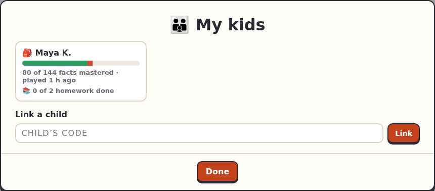

<title>Parents</title>

# Parents

Follow your child's progress and set extra homework.

1. **Get a code for your child.** Your child makes one on their account page (they tap their name at the top of the menu, then **Make a grown-up code**), or their teacher makes one for you. It works once, for 14 days.
2. **Sign in** with your own account (not your child's), and open the code's link, or type the code on your account page.
3. You're now a grown-up account: **👪 My kids** shows your child. For another child, type their code in **👪 My kids** › **Link a child**.

Tap your child for their page: the Times Table (mastered, learning, needs practice), their homework from the teacher and from you, and what they've played recently. **Add homework** there sets homework just for them; it only offers what they've already unlocked.

Your child's page also has **Delete Maya's account**: it removes the account and everything in it, for good. Your own account page has **Delete my account**.

What's kept about your child, and who can see it: [Privacy](../privacy.md).
